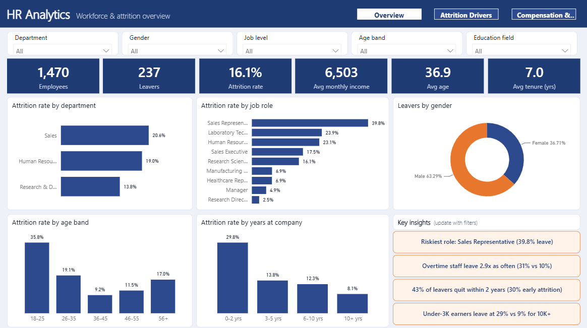
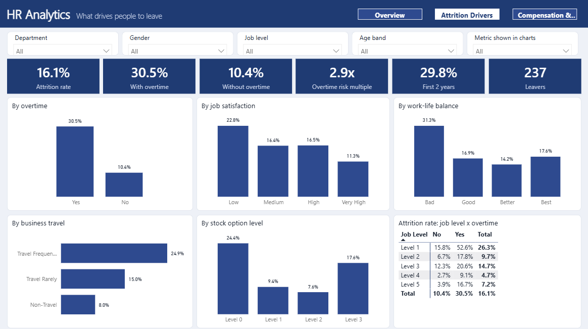
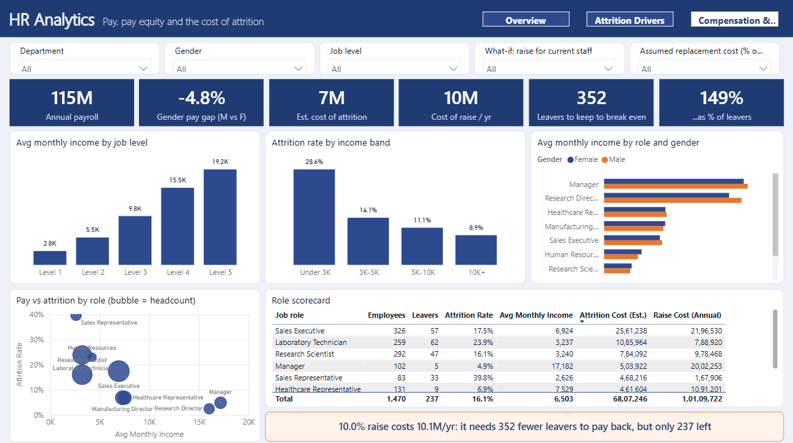

# HR Analytics: Attrition Drivers & Cost of Retention

A 3-page Power BI report that answers three questions an HR head would ask:

1. **Where** is attrition happening? (department, role, age, tenure)
2. **Why** are people leaving? (overtime, satisfaction, work-life balance, travel, stock options, pay)
3. **What would it cost** to keep them, and does a raise pay for itself?

Built on the IBM HR Analytics Employee Attrition dataset (1,470 employees, 35 attributes).



## Key findings

| # | Finding | Evidence |
|---|---------|----------|
| 1 | **Overtime is the strongest driver.** Overtime staff leave 2.9x as often. | 30.5% attrition with overtime vs 10.4% without |
| 2 | **Entry-level staff on overtime are the highest-risk group.** | Job level 1 + overtime: 52.6% attrition (82 of 156) |
| 3 | **The first two years are the danger zone.** | 43% of all leavers quit within 2 years; 29.8% attrition in that band vs 8.1% after 10 years |
| 4 | **Low pay matters, especially below your level's median.** | Under-3K earners leave at 28.6% vs 8.9% for 10K+; level-1 staff below their level median leave at 32.1% vs 20.6% |
| 5 | **Sales Representatives are the riskiest role.** | 39.8% attrition; Laboratory Technicians contribute the most leavers (62, 26% of all) |
| 6 | **No gender pay gap against women overall.** | Women earn 4.8% more on average; the largest role gap is Research Director (men +9.1%) |
| 7 | **A blanket raise does not pay for itself.** | A 10% raise for all current staff costs ~10.1M a year and would need to prevent 352 departures, 149% of the 237 who actually left |

**Recommendation:** target retention spend at job level 1 and overtime-heavy roles (cap overtime, review below-median pay, add stock options at level 1) instead of company-wide raises. The What-If page shows a 10% raise for level-1 staff alone must prevent 88 of 143 level-1 departures to break even.

## Report pages

| Page | What it shows |
|------|---------------|
| **Overview** | 6 KPI cards, attrition rate by department, job role, age band and tenure band, leavers by gender, and a **Key Insights** panel whose text is written by DAX and updates with every filter |
| **Attrition Drivers** | A **metric switch** (Attrition Rate / Leavers / Headcount) that re-drives every chart on the page: overtime, job satisfaction, work-life balance, business travel, stock options, plus a job level x overtime matrix |
| **Compensation & What-If** | Payroll, gender pay gap, income by level and role, attrition by income band, a pay-vs-attrition bubble chart, a role scorecard, and two **what-if parameters** (raise % and replacement cost %) that compute the cost of attrition, the cost of a raise and its break-even point |

All pages share synced slicers (department, gender, job level, age band) and button navigation.

|  |  |
|---|---|

## How it is built

**Data preparation (Power Query, M)**
- Dropped 3 constant columns (`EmployeeCount`, `Over18`, `StandardHours`) and 3 undocumented rate columns.
- Typed every column in one step; cleaned `Travel_Rarely` style values.
- Mapped coded fields to labels from the IBM data dictionary (education, satisfaction, work-life balance).
- Added age, tenure and income bands, each with a hidden order column so visuals sort logically, not alphabetically.
- The CSV path is a parameter (`DataFolder`), so the report works from any folder.

**Model**
- One employee fact table plus three disconnected helper tables: `Metric Selector` (metric switch), `Raise %` and `Replacement Cost %` (what-if parameters).
- 30 DAX measures in a dedicated `Measures` table, grouped into folders: KPIs, Drivers, Compensation, What-if, Insights. Implicit measures are disabled.

**DAX techniques used**
- `CALCULATE` with filter overrides (overtime vs no-overtime rates, early-tenure attrition).
- `SWITCH` + `SELECTEDVALUE` for the metric switch, with a **dynamic format string** so the same measure shows `16.1%` or `237`.
- `ADDCOLUMNS` + `FILTER` + `TOPN` to find the riskiest role (minimum 20 employees, to avoid ranking tiny groups).
- Text measures that build the Key Insights sentences from live numbers.
- What-if parameters through `SELECTEDVALUE` with defaults (10% raise, 50% replacement cost).

**SQL** ([sql/hr_analysis.sql](sql/hr_analysis.sql)): 16 queries that reproduce every number above: data-quality checks, attrition by segment, the overtime multiple, job level x overtime risk, pay ranges per level, the gender gap per role, below-median pay attrition (window functions for the median), and the raise break-even. Written for MySQL 8; also runs on SQLite and PostgreSQL.

## Assumptions

- The dataset has no dates, so the leavers are treated as one year of attrition.
- Replacing a leaver is assumed to cost 50% of their annual salary (recruiting, onboarding, lost output). The slicer lets the viewer test 25% to 150%.
- Income values are used as given in the dataset (no currency stated).

## Run it

1. Install [Power BI Desktop](https://powerbi.microsoft.com/desktop/) (free, Windows).
2. Clone or download this repo and open `HR-Analytics.pbip`.
3. If the data does not load: **Transform data → Edit parameters → DataFolder** and point it to this repo's `data\` folder (keep the trailing `\`), then **Refresh**.

## Repository

```
data/HR.csv                     IBM HR attrition dataset
sql/hr_analysis.sql             SQL analysis (16 queries)
HR-Analytics.pbip               Power BI project (open this)
HR-Analytics.SemanticModel/     model: Power Query, tables, DAX measures (TMDL, readable in any editor)
HR-Analytics.Report/            report pages and visuals (PBIR JSON)
docs/                           screenshots
```

The project is saved in Power BI's text-based PBIP format, so every measure and query can be read and reviewed on GitHub.

## Skills demonstrated

Power BI, DAX, Power Query (M), data modeling, what-if analysis, SQL (CTEs, window functions), KPI design, data storytelling.

## License

MIT
